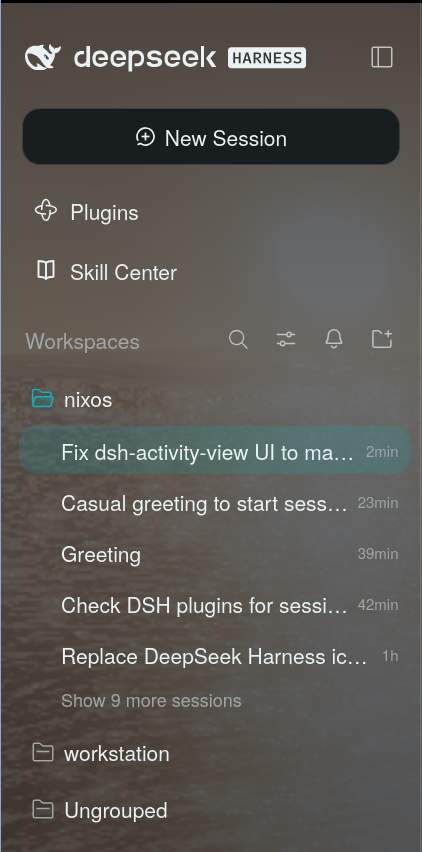
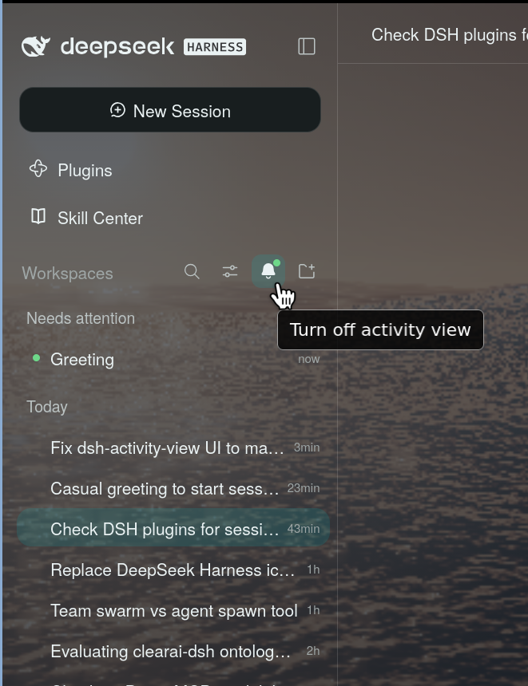

# dsh-activity-view

An activity view for the DeepSeek Harness web sidebar. A bell sits in the
sessions header, between the view options and the add-project button. Click it
to swap the session list for three groups:

| Group | A session shows here when |
|---|---|
| **Needs attention** | it finished while you looked elsewhere (unread), or it waits for an approval, a plan review or an answer |
| **Working** | it is running |
| **Today** | its last activity was today (local calendar day) |

<p align="center">
  
  &nbsp;&nbsp;
  
</p>
<p align="center"><sub>Left: the default sessions list. Right: the activity view, bell on.</sub></p>

Blank, subagent and archived sessions stay out. Unread rows get the green dot,
waiting rows the orange one, working rows the native spinner. The bell itself
shows a dot when anything needs attention, also while the view is off.

The bell is the only switch. The choice is stored in the browser under the
`dsh-activity-view.v2` localStorage key.

## Install

```sh
dsh plugin --profile web add github:vec715/dsh-activity-view
```

Restart the server, then reload the page. Remove it with:

```sh
dsh plugin --profile web remove dsh-activity-view
```

For development, add your local checkout instead:

```sh
git clone https://github.com/vec715/dsh-activity-view
dsh plugin --profile web add ./dsh-activity-view
```

## How it works

The shipped session browser owns `sidebar.workspaces` as one `single` slot,
header and list together. Replacing it would also replace search, view options
and add-project. So the plugin does two small DOM moves instead:

* the bell is appended to the shipped `headerActions` row and copies the class
  of the neighbouring icon button, so it looks and behaves like the others
* the shipped `listArea` is hidden while the view is on, and a React root with
  the activity list mounts beside it

Both anchors are CSS-module local names, which survive build hashes. A
MutationObserver puts the nodes back when the shell re-renders. Row metrics are
copied from the shipped session rows and use the same theme tokens.

## Develop

No build step. `client/client.js` is a hand-written loader bundle that the host
serves as a classic script. Edit it, then reload the page.

Types come from JSDoc, checked by `tsc` against `types.d.ts` (the few host
modules the plugin touches) and `@types/react`. Nothing is emitted.

```sh
npm install
npm run check   # tsc type-check, then the client self-check in node
```

## Known limits

* Unread state is process-local in DSH. A reload, a second tab, or a session
  that finished while the page was closed carries no unread mark.
* The DOM seam depends on the shipped `headerActions` and `listArea` class
  names. A DSH release that renames them will break the bell or the list.
* Row sizes are copied by hand from the shipped CSS. Check them after a DSH
  release that restyles the session list.
* English only.
